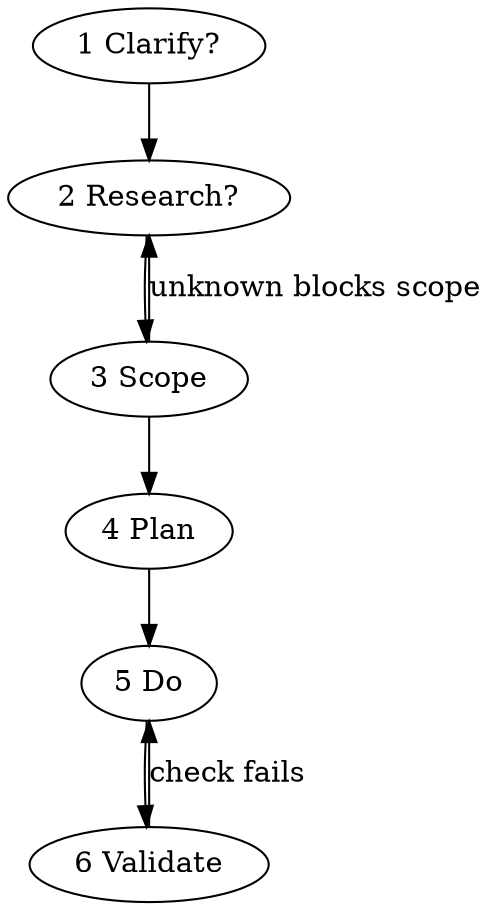

# Clarify, research, scope, plan, do, validate

Six steps in order; 1 and 2 are optional. Subagents do the reading and the
editing so your context keeps conclusions, not file dumps.

## 1. Clarify — optional

Ask with `AskUserQuestion` only when the answer is the user's to give and changes what you build:
a design choice, a trade-off, a balance number, or a request that reads two ways with different
results ("20% faster": 1.2× the rate, or 20% less time?). Anything the code, `CLAUDE.md` or `docs/` can
answer is research, not a question. Unambiguous request → skip to 2.

## 2. Research — optional

One `Explore` agent per independent question, all dispatched in one message, reading the primary
worktree (read-only). Skip when you already know which two or three files to read — read them
yourself.

## 3. Scope — required

Write it down, in the conversation, with these four parts:

- **In** — the behaviour that changes, the files that change, and the `docs/` passages that
  describe that behaviour.
- **Out** — what this task deliberately leaves alone.
- **Rules in play** — every `CLAUDE.md` rule the change touches, and the project skill that covers
  it if one does (`add-customer-order`, `tune-economy`).
- **Done when** — observable checks: a check script's output, an in-engine assertion, a value at
  load. "Looks right" is not a check.

If any part can only be filled in with a guess, go back to 2 with that gap as the question. Two
research rounds that still leave a gap → ask the user (step 1).

## 4. Plan — required

Numbered steps, each naming its file, its change, and which "Done when" check proves it. Mark the
steps that touch disjoint files and do not depend on each other — those run in parallel in step 5.
For a large or architectural change, hand the scope to a `Plan` agent and review what it returns
against the scope before adopting it.

Show the scope and plan to the user in one message. Proceed, unless step 1 left a question
open — then wait for the answer.

## 5. Do — required

Run `tools/agent/start.ps1 -Task <name>` **before the first edit**, `<name>` a short kebab-case
label for the change, and work only in the worktree it prints.

A one-step plan → make the edit yourself. Independent steps → one `general-purpose` agent each, dispatched in one message, never two agents
on the same file. Dependent steps run in order, yourself or one agent at a time. When a project
skill covers a step, the agent invokes it.

## 6. Validate — required

1. The checks `CLAUDE.md` § Working agreements requires for this change, each with
   `-Instance <name>` / `--instance <name>`, and every "Done when" check from the scope. Any change
   in behaviour, runtime or data-stage → `verify-in-engine`; "it loads" proves no number.
2. One fresh `general-purpose` reviewer: give it the scope and `git diff`, **not** your opinion of
   the diff, and ask for defects against the scope and the `CLAUDE.md` rules.
3. A failure goes back to 5. Then report each check with its output and ask the user for review —
   the work stays uncommitted. The skill ends here; after approval, `CLAUDE.md` § Working in
   parallel takes it from `integrate.ps1` to `finish.ps1`.

## Briefing a subagent

It knows only the prompt. Every brief has these parts, in this order:

1. **Goal** — one sentence, and what the result is used for.
2. **Context** — from step 5 on, the worktree path and `-Instance <name>`; the scope's "Rules in play", and what is
   already ruled out.
3. **Where to look** — files and docs by path; it reads them, you do not paste them.
4. **Boundary** — the files it may edit (research agents: none).
5. **Return** — the conclusion first, with `file:line` evidence, under 300 words.

## Common mistakes

| Mistake | Fix |
| --- | --- |
| Editing in the primary worktree | `start.ps1` first; the human plays on `main` |
| Scope with no "Done when" | Not a scope yet — step 6 has nothing to check |
| Telling the reviewer "I think it's fine" | Give it the diff and the scope only |
| Trusting a subagent's "done" | Step 6 re-runs every check itself |
